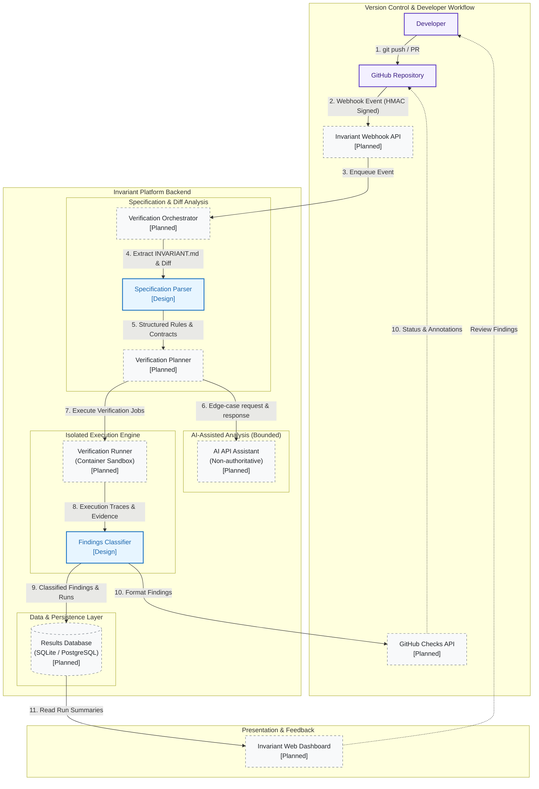
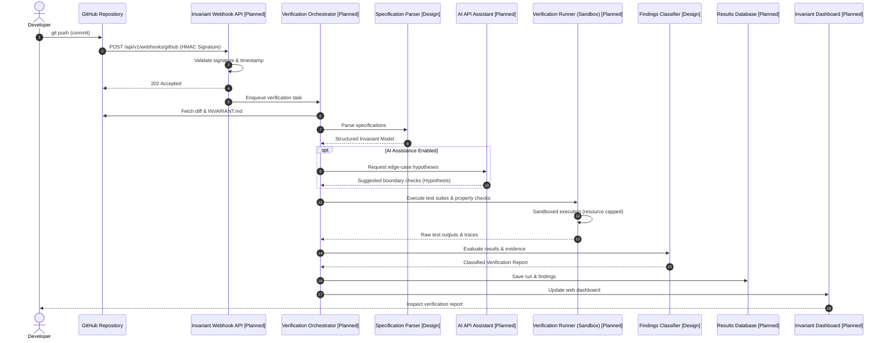

# Invariant

> **Continuous Verification for Every Commit**

Invariant is an automated software verification platform developed by Team INVICTUS for HackToBerFest-VVCE. It continuously verifies code commits and pull requests against declarative behavioral specifications declared in an `INVARIANT.md` specification file.

---

## Table of Contents

- [1. Project Overview](#1-project-overview)
- [2. Problem Statement](#2-problem-statement)
- [3. Our Approach](#3-our-approach)
- [4. How Invariant Works](#4-how-invariant-works)
- [5. Key Features](#5-key-features)
- [6. System Architecture Diagram](#6-system-architecture-diagram)
- [7. Sequence Diagram](#7-sequence-diagram)
- [8. Technology Stack](#8-technology-stack)
- [9. Project Structure](#9-project-structure)
- [10. Getting Started](#10-getting-started)
- [11. Configuration and Environment Variables](#11-configuration-and-environment-variables)
- [12. Running Locally](#12-running-locally)
- [13. Testing and Verification](#13-testing-and-verification)
- [14. Example Verification Workflow](#14-example-verification-workflow)
- [15. Security Considerations](#15-security-considerations)
- [16. Current Limitations](#16-current-limitations)
- [17. Roadmap](#17-roadmap)
- [18. Contributing](#18-contributing)
- [19. How GitHub Copilot Was Used During Development](#19-how-github-copilot-was-used-during-development)
- [20. License](#20-license)

---

## 1. Project Overview

Modern CI/CD pipelines run tests, but they only test the specific scenarios developers anticipated. Critical business logic, safety rules, and state invariants—such as ensuring accounts never go negative, permissions are never bypassed, and data transformations remain idempotent—often escape standard test suites.

Invariant turns software specifications into active, continuous verification guards. By co-locating machine-parseable invariants in `INVARIANT.md` alongside application code, Invariant analyzes changes on every commit, coordinates sandboxed execution, applies AI-assisted boundary analysis, and reports evidence-backed findings directly into pull requests.

---

## 2. Problem Statement

1. **Disconnected Requirements**: Functional requirements live in documentation wikis, tickets, or design docs, drifting out of sync with production code.
2. **Incomplete Test Coverage**: Standard unit tests cover known happy paths and selected edge cases, frequently missing concurrency hazards, state corruptions, and boundary overflows.
3. **Unreliable AI Code Reviews**: Unconstrained AI code reviewers often hallucinate bugs, output false positives, or approve flawed code because they lack empirical verification mechanisms.
4. **Silent CI Failures**: When a CI check times out or crashes due to missing tooling, traditional systems often fail silently or report misleading green checkmarks.

---

## 3. Our Approach

Invariant introduces an empirical, specification-driven verification pipeline:

* **Executable Specifications (`INVARIANT.md`)**: Requirements are versioned alongside code, defining explicit invariants, API contracts, boundary values, and error behaviors.
* **Empirical Grounding**: Verification outcomes are backed by reproducible execution traces, assertion failures, or deterministic proofs.
* **Bounded AI Assistance**: An AI API model is employed exclusively as an exploratory advisor—generating edge-case hypotheses and stress inputs. AI outputs **never** mark a build as failed unless the execution runner independently reproduces a concrete failure.
* **Fail-Safe Integrity**: Unexecuted, crashing, or timed-out checks are classified as inconclusive errors (`CHECK_ERROR`), never as false passes.

---

## 4. How Invariant Works

```
[Developer git push]
        |
        v
[GitHub Webhook Event] ──(HMAC Verified)──> [Invariant Ingress API]
                                                   |
                                                   v
[Parse INVARIANT.md & Diff] <─────────────── [Verification Orchestrator]
                                                   |
                    +──────────────────────────────+──────────────────────────────+
                    |                                                             |
                    v (Edge-Case Hypotheses)                                      v (Dispatch Test Jobs)
        [AI API Assistant] (Bounded)                                  [Container Sandbox Runner]
                    |                                                             |
                    +──────────────────────────────+──────────────────────────────+
                                                   |
                                                   v
                                      [Findings Classifier]
                                  (Verified / Warning / Error)
                                                   |
                    +──────────────────────────────+──────────────────────────────+
                    |                                                             |
                    v                                                             v
        [Results Database & Dashboard]                                [GitHub Checks & Annotations]
```

1. **Trigger**: A developer pushes a commit or opens a pull request.
2. **Ingest & Validate**: The Ingress API validates the webhook's cryptographic HMAC signature.
3. **Parse & Plan**: The Orchestrator extracts `INVARIANT.md` from the commit and maps changed files to invariant rules.
4. **Synthesize & Explore**: If enabled, the AI API suggests edge cases and boundary conditions for the changed code.
5. **Execute in Sandbox**: The Runner executes property-based and unit tests inside an isolated container with hard resource limits and timeouts.
6. **Classify Evidence**: Results are categorized into `VERIFIED_PASS`, `VERIFIED_FAILURE`, `STATIC_WARNING`, `AI_HYPOTHESIS`, or `CHECK_ERROR`.
7. **Report**: Findings are published to the web dashboard and posted back to the GitHub Checks API with inline code annotations.

---

## 5. Key Features

* **Continuous Specification Enforcement**: Automated evaluation of business rules on every `push` and `pull_request`.
* **Standardized Specification Schema**: Human-readable and machine-parseable `INVARIANT.md` format supporting invariants, contracts, and error states.
* **Evidence-Based Finding Classification**: Distinct categorization separating verified dynamic failures from static warnings and unverified AI hypotheses.
* **Isolated Sandbox Execution**: Ephemeral container environments with restricted capabilities, resource quotas, and hard timeouts.
* **Fail-Safe Verification Model**: Strict policy guaranteeing that unexecuted or crashed checks are never reported as passing.
* **GitHub Checks Integration**: Line-level annotations and summary reports delivered directly to code reviewers on GitHub.

---

## 6. System Architecture Diagram

The diagram below outlines the system components and data flow. For an exhaustive architectural breakdown, see [docs/architecture.md](docs/architecture.md).



---

## 7. Sequence Diagram

Below is the verification sequence triggered by a code push. For detailed explanations, see [docs/sequence-diagram.md](docs/sequence-diagram.md).



---

## 8. Technology Stack

| Layer | Component | Technology / Library | Status |
| :--- | :--- | :--- | :--- |
| **Backend API** | Ingress, Webhooks & REST | Python 3.10+ / FastAPI / Uvicorn | Implemented (MVP) |
| **Core Packages** | Spec Parser, Verifier, AI, Report | Python / DataClasses / AST | Implemented (MVP) |
| **Spec Engine** | Markdown & Frontmatter Parser | Python Markdown Parser / Pydantic | Implemented (MVP) |
| **Sandbox Runner** | Isolated Process & Timeout Watchdog | Ephemeral Subprocess Runner / Docker | Implemented (MVP) |
| **AI Assistant** | Edge-Case Hypothesis Generator | Provider-Independent AI Interface | Implemented (MVP) |
| **Database** | Persistence & Audit Store | SQLite (Dev) / PostgreSQL (Prod) via SQLAlchemy | Implemented (MVP) |
| **Frontend** | Verification Web Dashboard | Next.js 14 / TypeScript / Tailwind CSS | Implemented (MVP) |
| **CI / Integration** | Continuous Verification Action | GitHub Actions (`actions/verify`) & Webhooks | Implemented (MVP) |

---

## 9. Project Structure

```text
Invariant/
├── apps/
│   └── web/                      # Next.js 14 Web Dashboard (TypeScript + Tailwind CSS)
│       ├── public/
│       └── src/
│           ├── components/       # StatusBadge, RunCard, FindingCard, Navbar
│           ├── pages/            # Dashboard (index.tsx), Run Details (runs/[id].tsx)
│           ├── hooks/            # useRuns custom hook
│           ├── services/         # Typed API client for FastAPI backend
│           ├── types/            # TypeScript domain interfaces
│           └── styles/           # Tailwind CSS global styles
│
├── services/
│   └── api/                      # FastAPI Backend API Service
│       ├── app/
│       │   ├── api/v1/           # REST endpoints (/runs, /repositories)
│       │   ├── core/             # Settings, Database session, HMAC Security
│       │   ├── models/           # SQLAlchemy ORM models (Repository, Run, Finding)
│       │   ├── schemas/          # Pydantic validation schemas
│       │   ├── services/         # Verification orchestrator service
│       │   ├── webhooks/         # GitHub webhook ingress with HMAC-SHA256
│       │   └── main.py           # FastAPI application entrypoint
│       ├── tests/                # API and cryptographic security test suites
│       └── requirements.txt      # Backend Python dependencies
│
├── packages/                     # Modular, decoupled verification packages
│   ├── spec_engine/              # INVARIANT.md Markdown AST parser & validator
│   ├── verifier/                 # Isolated test runner & adapters (Pytest, Generic)
│   │   └── adapters/             # PytestAdapter, GenericTestAdapter
│   ├── ai_engine/                # Provider-independent AI interface (bounded)
│   └── report_engine/            # Findings normalizer, Markdown & JSON generators
│
├── actions/
│   └── verify/                   # GitHub Action definition (action.yml)
│
├── migrations/                   # Database DDL schemas (SQLite & PostgreSQL)
│   └── 001_initial_schema.sql
│
├── examples/
│   └── inventory-api/            # Reference service demonstrating continuous verification
│       ├── INVARIANT.md          # Invariant specification (INV-01, INV-02, INV-03)
│       ├── src/                  # Thread-safe inventory implementation
│       └── tests/                # Pytest invariant test suite
│
├── tests/                        # Top-level integration & end-to-end MVP tests
├── docs/                         # Architecture, threat model, specs, and guides
│   ├── architecture.md           # System architecture & component responsibilities
│   ├── sequence-diagram.md       # End-to-end execution sequence diagram
│   ├── technical-design.md       # Technical design specification & trade-offs
│   ├── threat-model.md           # STRIDE security analysis & risk mitigations
│   ├── specification-format.md   # INVARIANT.md grammar, schema & inventory example
│   ├── verification-model.md     # Findings taxonomy & verification evidence rules
│   ├── copilot-development.md    # AI-assisted development guide & session logs
│   └── implementation-plan.md    # Architecture implementation plan
│
├── .github/
│   ├── workflows/                # CI (ci.yml) and verification (verify.yml)
│   ├── ISSUE_TEMPLATE/           # Bug report and feature request templates
│   └── PULL_REQUEST_TEMPLATE.md
├── README.md                     # Main documentation entrypoint
├── HOW-TO-USE.md                 # User guide: Connecting repos, defining rules, inspecting runs
├── INVARIANT.md                  # Invariant specification for the platform
├── CONTRIBUTING.md               # Standard contributor guide
├── SECURITY.md                   # Security policy & vulnerability reporting
├── AGENT.md                      # Operational guide for AI coding agents
├── LICENSE                       # MIT License
├── tracker.md                    # Active development log & decision record
├── pytest.ini                    # Pytest configuration
├── .gitignore                    # Comprehensive ignores for Python, Node, DB
└── .env.example                  # Environment configuration template
```

### Documentation Index

#### 1. Core Technical Documentation (`docs/`)

Every technical document in the [`docs/`](docs/) directory covers a dedicated architectural facet of Invariant:

| Document | Purpose & Key Topics |
| :--- | :--- |
| [`docs/architecture.md`](docs/architecture.md) | **System Architecture**: High-level Mermaid flowchart, subsystem responsibilities (API, Orchestrator, Parser, Runner, AI Assistant, Database, Dashboard), data flow, and technology decisions. |
| [`docs/sequence-diagram.md`](docs/sequence-diagram.md) | **Sequence Flow**: Detailed 12-phase Mermaid sequence diagram tracing a code push or PR through HMAC validation, spec extraction, sandboxed execution, and GitHub Checks. |
| [`docs/technical-design.md`](docs/technical-design.md) | **Technical Design Specification**: System goals and non-goals, AST specification parsing, verification pipeline stages, bounded AI integration, error handling, retries, and scalability. |
| [`docs/threat-model.md`](docs/threat-model.md) | **Threat Model & Security**: STRIDE security analysis covering all 9 attack surfaces (sandbox escapes, prompt injection, credential exposure, replayed webhooks, DoS, etc.) and technical mitigations. |
| [`docs/specification-format.md`](docs/specification-format.md) | **Specification Guide**: Grammar, schema, authoring rules, and an illustrative inventory management API specification for `INVARIANT.md`. |
| [`docs/verification-model.md`](docs/verification-model.md) | **Verification Taxonomy**: 6-tier outcome classification (`VERIFIED_PASS`, `VERIFIED_FAILURE`, etc.), fail-safe inconclusive reporting principles, and structured JSON finding schema. |
| [`docs/copilot-development.md`](docs/copilot-development.md) | **AI-Assisted Engineering Guide**: Guidelines for utilizing GitHub Copilot Agent across 7 development phases, human-in-the-loop safeguards, and standardized dev session log template. |
| [`docs/implementation-plan.md`](docs/implementation-plan.md) | **Implementation Plan**: Architectural roadmap, module boundaries, prioritized working path, and implementation milestones for the Invariant platform. |

#### 2. Root Governance & Operational Documents

| Document | Purpose & Description |
| :--- | :--- |
| [`HOW-TO-USE.md`](HOW-TO-USE.md) | Practical step-by-step user guide for connecting repositories, defining rules in `INVARIANT.md`, submitting PRs, and reviewing findings. |
| [`INVARIANT.md`](INVARIANT.md) | Declarative behavioral specification defining invariants (`INV-01` to `INV-04`), API contracts, edge cases, and failure expectations for Invariant. |
| [`CONTRIBUTING.md`](CONTRIBUTING.md) | Contributor setup, development workflow, testing requirements, and PR guidance. |
| [`SECURITY.md`](SECURITY.md) | Security policy, vulnerability reporting SLA, and architectural controls. |
| [`AGENT.md`](AGENT.md) | Operational guidelines, commands, and invariant rules for AI coding agents. |
| [`LICENSE`](LICENSE) | Standard MIT License. |
| [`tracker.md`](tracker.md) | Active development log, recording actual decisions, milestones, and test outputs. |

---

## 10. Getting Started

### Prerequisites
* **Git** 2.30+
* **Python** 3.10+
* **Node.js** 18+ (for Web Dashboard)

### Installation
```bash
# 1. Clone repository
git clone https://github.com/HackToBerFest-VVCE/t2c2-invictus.git
cd t2c2-invictus

# 2. Set up Python virtual environment
python -m venv .venv
# On Windows:
.venv\Scripts\Activate.ps1
# On Linux/macOS:
source .venv/bin/activate

# 3. Install backend & verification dependencies
pip install --upgrade pip
pip install -r services/api/requirements.txt
```

---

## 11. Configuration and Environment Variables

Configuration is managed via environment variables or a `.env` file (copied from `.env.example`):

| Variable | Description | Default | Required |
| :--- | :--- | :--- | :--- |
| `INVARIANT_ENV` | Runtime environment (`development`, `production`, `test`) | `development` | No |
| `INVARIANT_PORT` | HTTP port for webhook ingress | `8000` | No |
| `GITHUB_WEBHOOK_SECRET` | Shared secret for validating GitHub HMAC signatures | - | Yes (in Prod) |
| `GITHUB_APP_ID` | GitHub App ID for Checks API authentication | - | Planned |
| `GITHUB_PRIVATE_KEY_PATH` | Path to GitHub App private key PEM file | - | Planned |
| `DATABASE_URL` | Connection URL for results database | `sqlite:///./invariant.db` | No |
| `AI_PROVIDER` | AI Provider (`mock`, `api`) | `mock` | No |
| `AI_API_KEY` | API key for AI assistant edge-case suggestions | - | Optional |
| `AI_API_BASE_URL` | Base endpoint URL for AI model provider | `https://api.openai.com/v1` | Optional |
| `RUNNER_TIMEOUT_SECONDS` | Maximum execution time before runner is killed | `300` | No |

---

## 12. Running Locally

### 1. Run Verification via CLI
Verify a project directly from the command line:
```bash
# Run verification on the reference inventory API
python -m packages.verifier.cli --workspace examples/inventory-api --spec INVARIANT.md
```

### 2. Start the Backend API Service
```bash
# Start FastAPI backend on http://localhost:8000
python -m uvicorn services.api.app.main:app --host 0.0.0.0 --port 8000 --reload
```
Swagger UI documentation is available at `http://localhost:8000/docs`.

### 3. Start the Web Dashboard
```bash
cd apps/web
npm install
npm run dev
```
Open `http://localhost:3000` to inspect runs, findings, and evidence traces.

---

## 13. Testing and Verification

Run the comprehensive automated test suite (all 16 integration, unit, and end-to-end tests):

```bash
# Run all tests across packages and API
python -m pytest -v

# Run reference example tests directly
python -m pytest examples/inventory-api/tests -v
```

---

## 14. Example Verification Workflow

Consider an inventory service specifying:
> **INV-01**: Available stock must never drop below 0 under any sequence of requests.

1. A developer refactors `reserve_stock()` but omits database row locking during concurrent reservations.
2. The developer pushes a commit to their pull request.
3. Invariant detects the change affecting `services/inventory/service.py` mapped to `INV-01`.
4. The AI Assistant generates a high-concurrency race condition scenario.
5. The Verification Runner executes the property-based test harness inside the sandbox.
6. The test fails: `AssertionError: item.available_stock is -2`.
7. Invariant classifies the result as **`VERIFIED_FAILURE`** and posts a failing GitHub Check run with the exact stack trace and reproduction seed.

---

## 15. Security Considerations

* **Isolated Sandbox Execution**: Untrusted code executed during verification runs in single-use containers with dropped Linux capabilities and memory/CPU limits.
* **Zero Secret Exposure**: Host credentials, GitHub App private keys, and AI API keys are never mounted into test execution sandboxes.
* **Webhook Replay & Spoofing Defense**: All incoming payloads require HMAC-SHA256 signature verification and timestamp drift validation.
* **Non-Authoritative AI Boundary**: AI models cannot mark builds as failed; all reported bugs require reproducible execution traces.

For the full security assessment, see the [docs/threat-model.md](docs/threat-model.md).

---

## 16. Current Limitations

* **Hackathon Bootstrap State**: The project is currently transitioning from specification and architectural design into initial module implementation.
* **Automated Test Synthesis**: Automated translation of natural-language invariant prose into executable property tests is experimental and requires human review.
* **Language Ecosystem**: Initial execution sandboxes prioritize Python and JavaScript/TypeScript test frameworks.

---

## 17. Roadmap

* [x] **Milestone 1**: Core system architecture, specification schema, and threat model specification.
* [x] **Milestone 2**: Ingestion API with HMAC validation and `INVARIANT.md` AST parser.
* [x] **Milestone 3**: Ephemeral runner sandbox with resource constraints and timeout watchdogs.
* [x] **Milestone 4**: Findings classification engine, lifecycle tracker, and SQLite persistence layer.
* [x] **Milestone 5**: GitHub Checks API integration, PR annotation reporter, and export generators.
* [x] **Milestone 6**: Web dashboard for continuous verification, run exploration, and test gap analysis.
* [ ] **Milestone 7**: Extended multi-language verification engines (Rust, Go) and distributed cloud runners.

---

## 18. Contributing

Contributions are warmly welcomed! Please read [CONTRIBUTING.md](CONTRIBUTING.md) for details on code style, branch conventions, local setup, and pull request procedures.

---

## 19. How GitHub Copilot Was Used During Development

GitHub Copilot Agent assisted during the initial design and documentation phase by:
* Facilitating rapid architectural exploration and dependency evaluation.
* Structuring Markdown specifications, schemas, and GitHub-compatible Mermaid diagrams.
* Reviewing edge cases, security boundaries, and STRIDE threat categories.

For guidelines on using Copilot as a pair programmer on Invariant, see [docs/copilot-development.md](docs/copilot-development.md).

---

## 20. License

This project is licensed under the MIT License - see the [LICENSE](LICENSE) file for details.
