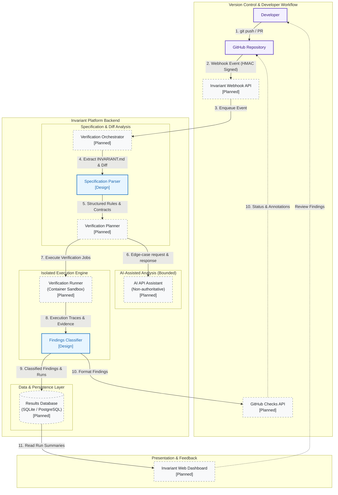

# Invariant System Architecture

This document describes the system architecture of **Invariant**, a continuous software verification platform designed to evaluate code commits and pull requests against explicit invariant specifications declared in `INVARIANT.md`.

---

## 1. Architectural Overview & Implementation Status

Invariant is structured as an event-driven verification platform. When code changes occur, Invariant reconciles the changed code against declared invariants, runs isolated verification routines, uses an AI API strictly for hypothesis and edge-case generation, and yields an evidence-backed verification report.

> [!NOTE]
> **Implementation Status Notice**: Invariant is currently in its active bootstrap and design phase for the Hacktoberfest hackathon. Core architectural interfaces, specification schemas, threat models, and verification abstractions are established. Subsystems marked as **[Planned]** represent roadmap milestones currently in scaffolding, while **[Specification/Design]** represents completed design contracts ready for implementation.

| Subsystem | Component | Status | Responsibility |
| :--- | :--- | :--- | :--- |
| **GitHub Integration** | Webhook Receiver & GitHub App | Planned | Ingest and validate signed GitHub webhook events (`push`, `pull_request`). |
| **GitHub Integration** | Checks API Reporter | Planned | Publish check runs, summary annotations, and verification status back to GitHub PRs. |
| **Backend Core** | Verification Orchestrator | Planned | Pipeline manager that coordinates parsing, sandbox execution, AI assistance, and storage. |
| **Specification** | `INVARIANT.md` Parser | Specification/Design | Extracts structured invariants, invariants metadata, contracts, and rule sets. |
| **Execution Sandbox** | Verification Runner | Planned | Ephemeral, isolated execution environment executing dynamic test runs and property tests. |
| **AI Assistant** | AI API Gateway | Planned | Bounded LLM interface generating edge-case hypotheses and synthesis plans (non-authoritative). |
| **Storage & Data** | Results Database | Planned | Relational store recording verification runs, execution logs, and classified findings. |
| **Frontend UI** | Verification Dashboard | Planned | Web-based interface displaying run histories, invariant coverage, and finding triage. |

---

## 2. High-Level Architecture Flowchart

The following Mermaid diagram illustrates the end-to-end data flow and component relationships across Invariant.



---

## 3. Subsystem Breakdown and Responsibilities

### 3.1 Web Application and User Interface (`dashboard/`)
* **Status**: Planned.
* **Responsibilities**:
  * Provide visual dashboards showing verification status across repositories, branches, and commits.
  * Render human-readable summaries of invariant compliance (e.g., passing rules, warning indicators, and reproducible failures).
  * Allow team members to review execution traces, console outputs, and reproduction scripts.
  * Display history and trends of invariant stability over time.

### 3.2 Backend API and Webhook Processing (`api/`)
* **Status**: Planned.
* **Responsibilities**:
  * Receive incoming webhook requests from GitHub (such as `push` and `pull_request` triggers).
  * Enforce security boundary by validating HMAC SHA-256 signatures using configured webhook secrets.
  * Perform replay protection via timestamp and delivery UUID checks.
  * Parse git metadata (repository name, commit SHA, branch reference, sender).
  * Push verification tasks onto an asynchronous job queue for orchestrator processing.

### 3.3 Verification Orchestrator (`orchestrator/`)
* **Status**: Planned.
* **Responsibilities**:
  * Manage the lifecycle of each verification run from receipt to completion.
  * Retrieve the repository tree, changed diffs, and the target specification (`INVARIANT.md`).
  * Invoke the Specification Parser to extract requirements and invariant rules.
  * Determine applicable verification strategies based on modified files and associated rules.
  * Coordinate calls to the AI API assistant for optional requirement clarification or edge-case hypotheses.
  * Dispatch jobs to the Verification Runner and wait for execution results.
  * Forward results to the Findings Classifier and trigger report publication.

### 3.4 Specification Analysis (`spec/`)
* **Status**: Specification/Design complete; parser implementation planned.
* **Responsibilities**:
  * Parse `INVARIANT.md` into structured domain models:
    * **Metadata**: Spec version, target project, language requirements.
    * **Invariants**: Unconditional business rules and logical assertions.
    * **API Contracts**: Input schemas, pre-conditions, post-conditions, and expected error statuses.
    * **Edge Cases & Failure Modes**: Boundary conditions and required handling.
  * Validate specification syntax and flag ambiguous or non-testable clauses.
  * Map specification rules to source code files and test suites.

### 3.5 Test Execution and Verification Runner (`runner/`)
* **Status**: Planned.
* **Responsibilities**:
  * Spin up ephemeral, sandboxed environments (containerized or isolated processes).
  * Check out the exact commit under evaluation.
  * Execute deterministic unit, integration, and property-based test suites.
  * Enforce strict resource limits: CPU throttling, memory caps, network egress restrictions, and hard wall-clock timeouts.
  * Capture execution artifacts: stdout, stderr, exit codes, assertion errors, and stack traces.

### 3.6 AI-Assisted Analysis (`ai/`)
* **Status**: Planned.
* **Responsibilities & Strict Boundaries**:
  * **Role**: Act strictly as an exploratory assistant and edge-case generator; **never** as the final arbiter of correctness.
  * **Input**: Specification excerpts, changed code diffs, and error signatures.
  * **Output**: Suggested test inputs, potential edge cases, boundary scenarios, and explanations of complex test failures.
  * **Boundary Rule**: An AI suggestion remains classified as an `AI_HYPOTHESIS` until the Verification Runner reproduces a concrete test failure. AI outputs cannot directly produce confirmed bug reports.

### 3.7 Results Storage Layer (`db/`)
* **Status**: Planned.
* **Responsibilities**:
  * Persist verification runs, repository metadata, commit SHAs, and timestamp records.
  * Store classified findings with foreign key references to specific runs and invariant clauses.
  * Store diagnostic logs, execution traces, and reproduction scripts.
  * Support querying for dashboard visualization, trending, and audit compliance.

### 3.8 GitHub Integration (`integrations/github/`)
* **Status**: Planned.
* **Responsibilities**:
  * Authenticate as a GitHub App using private keys and installation tokens.
  * Create and update GitHub Check Runs on the target commit.
  * Translate classified findings into inline code annotations on Pull Request diffs.
  * Post high-level verification summaries to Pull Request comment threads.

---

## 4. End-to-End Data Flow

```
+---------------+     Webhook Event       +--------------------+
| GitHub Repo   | ----------------------> | Invariant API      |
+---------------+   (Signed payload)      +--------------------+
                                                     |
                                                     v
+--------------------+   Parse & Plan     +--------------------+
| INVARIANT.md Spec  | <----------------- | Orchestrator       |
+--------------------+                    +--------------------+
                                                     |
                                                     +-----------------------------+
                                                     |                             |
                                                     v (Generate hypotheses)       v (Dispatch jobs)
                                          +--------------------+        +--------------------+
                                          | AI API Assistant   |        | Isolated Runner    |
                                          | (Edge cases/tests) |        | (Executes tests)   |
                                          +--------------------+        +--------------------+
                                                     |                             |
                                                     +--------------+--------------+
                                                                    |
                                                                    v
                                                          +--------------------+
                                                          | Finding Classifier |
                                                          +--------------------+
                                                                    |
                                                     +--------------+--------------+
                                                     |                             |
                                                     v                             v
                                          +--------------------+        +--------------------+
                                          | Results Database   |        | GitHub Checks API  |
                                          +--------------------+        +--------------------+
                                                     |                             |
                                                     v                             v
                                          +--------------------+        +--------------------+
                                          | Web Dashboard      |        | Developer Review   |
                                          +--------------------+        +--------------------+
```

1. **Trigger**: A developer pushes a commit or opens a PR on GitHub.
2. **Ingress**: GitHub delivers an event payload to `/api/v1/webhooks/github`.
3. **Validation**: The webhook receiver verifies the HMAC-SHA256 signature against the shared secret.
4. **Orchestration**: The Orchestrator receives the validated event, checks out the repository commit, and reads `INVARIANT.md`.
5. **Spec Extraction**: The Specification Parser extracts formal invariant clauses and maps them to changed source paths.
6. **Hypothesis & Plan**: The Orchestrator constructs a verification plan. If configured, the AI API suggests edge cases or boundary values for dynamic testing.
7. **Execution**: The Runner executes the verification jobs in a sandbox with timeouts and network restrictions.
8. **Classification**: Test outputs, stack traces, and static findings are passed to the Classifier, categorizing each result according to empirical evidence.
9. **Persistence**: Results, traces, and metrics are committed to the Results Database.
10. **Feedback**: The GitHub integration updates the commit status via the Checks API and renders findings on the Invariant Dashboard.

---

## 5. Technology Stack Decisions (Planned)

| Component | Selected / Proposed Technology | Rationale |
| :--- | :--- | :--- |
| **API & Backend** | Python 3.11+ / FastAPI | High performance async I/O, strong typing via Pydantic, rich ecosystem for AST parsing and test runners. |
| **Task Queue** | Redis + Celery / ARQ | Reliable background task dispatching with retry handling and failure isolation. |
| **Sandboxing** | Docker / gVisor container runners | Ephemeral process isolation, filesystem isolation, strict network controls, and cgroup limits. |
| **Storage** | PostgreSQL (Prod) / SQLite (Dev) | Structured relational schema for runs, invariants, findings, and audit trails. |
| **Frontend** | React / Next.js or Lightweight SSR | Fast dashboard rendering with minimal runtime overhead. |
| **AI Integration** | Provider-agnostic AI API Client | Abstracts model providers (OpenAI, Anthropic, local LLMs) via a standard prompt/response interface. |

---

## 6. Related Documentation

* [Sequence Diagram](sequence-diagram.md) - Detailed step-by-step verification execution trace.
* [Technical Design](technical-design.md) - Comprehensive technical architecture, goals, and trade-offs.
* [Threat Model](threat-model.md) - STRIDE security analysis, attack surfaces, and risk mitigations.
* [Specification Format](specification-format.md) - Structure and grammar of `INVARIANT.md`.
* [Verification Model](verification-model.md) - Invariant findings taxonomy and evidence criteria.
* [GitHub Copilot Guide](copilot-development.md) - AI-assisted development workflow and session templates.
