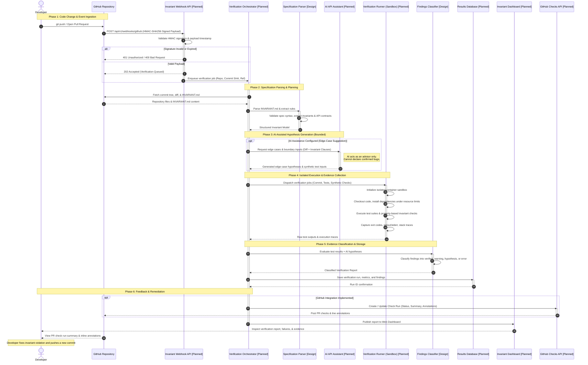

# Invariant Verification Sequence Diagram

This document illustrates the execution lifecycle of a continuous verification cycle in **Invariant**, tracing interactions from a developer's code change on GitHub through specification parsing, sandboxed execution, AI-assisted edge-case hypothesis generation, classification, and reporting.

---

## 1. Sequence Overview

The sequence represents the end-to-end verification flow. Components marked with **[Planned]** reflect the target architecture during the current hackathon development phase.

---

## 2. Step-by-Step Stage Breakdown

### Stage 1: Ingestion & Validation
1. **Developer Action**: The developer pushes a commit or opens/updates a Pull Request on GitHub.
2. **Webhook Ingestion**: GitHub dispatches an HTTPS `POST` payload containing the commit metadata, repository information, and an `X-Hub-Signature-256` header.
3. **HMAC Validation**: Invariant's webhook handler verifies the payload signature using the configured secret key. Malformed or unauthenticated requests are rejected immediately with `401 Unauthorized`.
4. **Job Enqueueing**: Upon validation, the event is acknowledged with `202 Accepted` and enqueued onto the internal asynchronous task queue.

### Stage 2: Specification Parsing & Planning
5. **Git Tree Retrieval**: The orchestrator checks out the commit diff and locates `INVARIANT.md` in the repository root.
6. **Specification Parsing**: The parser converts `INVARIANT.md` into an abstract syntax tree of formal statements:
   * Logical invariants (e.g., `account.balance >= 0`).
   * API contracts (pre-conditions, post-conditions, response codes).
   * Declared failure modes and expected error envelopes.
7. **Rule Mapping**: The orchestrator matches modified source files against relevant invariant clauses.

### Stage 3: AI-Assisted Analysis (Bounded)
8. **Hypothesis Generation**: If AI assistance is enabled, Invariant invokes the AI API with:
   * The text of the affected invariant clauses.
   * The unified git diff of the commit.
9. **Role of AI**: The AI API suggests prospective edge cases (e.g., integer overflow boundaries, concurrent access scenarios, null payload structures).
10. **Strict Non-Authoritative Boundary**: The AI API **cannot** declare a bug or fail a build. All AI suggestions are treated as unverified hypotheses until dynamically confirmed or refuted by the execution runner.

### Stage 4: Sandboxed Test Execution
11. **Sandbox Allocation**: The Verification Runner initializes an ephemeral container environment with strict memory, CPU, and network limits.
12. **Execution**: The runner runs:
    * Existing repository unit and integration test suites.
    * Invariant property-based test harnesses.
    * Synthesized tests derived from edge-case hypotheses.
13. **Evidence Capture**: The runner logs stdout, stderr, process exit codes, and call traces as cryptographic or log-level evidence.

### Stage 5: Classification & Storage
14. **Evidence-Based Classification**: The Findings Classifier maps execution outputs into distinct categories:
    * **`VERIFIED_PASS`**: Check ran and passed assertions.
    * **`VERIFIED_FAILURE`**: Check ran and produced an unequivocal reproduced failure.
    * **`STATIC_WARNING`**: Identified via static analysis without dynamic runtime reproduction.
    * **`AI_HYPOTHESIS`**: Suggested by AI but not yet reproduced by a concrete test.
    * **`CHECK_ERROR`**: Test could not execute due to environment or configuration faults.
15. **Persistence**: The run record, individual findings, and associated evidence logs are committed to the Results Database.

### Stage 6: Reporting & Remediation
16. **GitHub Checks**: The GitHub integration creates a Check Run on the commit, posting a high-level summary and inline annotations on lines with verified failures.
17. **Dashboard Notification**: The run is available on the Invariant web dashboard for interactive investigation.
18. **Developer Remediation**: The developer reviews the actionable evidence (trace, expected vs. actual behavior), updates their code, and pushes a subsequent commit, re-triggering the verification pipeline.

---

## 3. Planned vs. Designed Elements

| Sequence Step | Implementation Status | Notes |
| :--- | :--- | :--- |
| **HMAC Webhook Processing** | Planned | Endpoint design and signature verification algorithms specified. |
| **`INVARIANT.md` Parsing** | Specification/Design Complete | Schema and markdown section conventions defined. |
| **AI Hypothesis Generation** | Planned | Prompt architecture and boundary rules specified. |
| **Sandbox Execution** | Planned | Container execution harness and timeout mechanics defined. |
| **Evidence Classification** | Specification/Design Complete | Formal finding classification taxonomy fully specified. |
| **GitHub Checks Publishing** | Planned | GitHub App manifest and Check Run payloads specified. |
