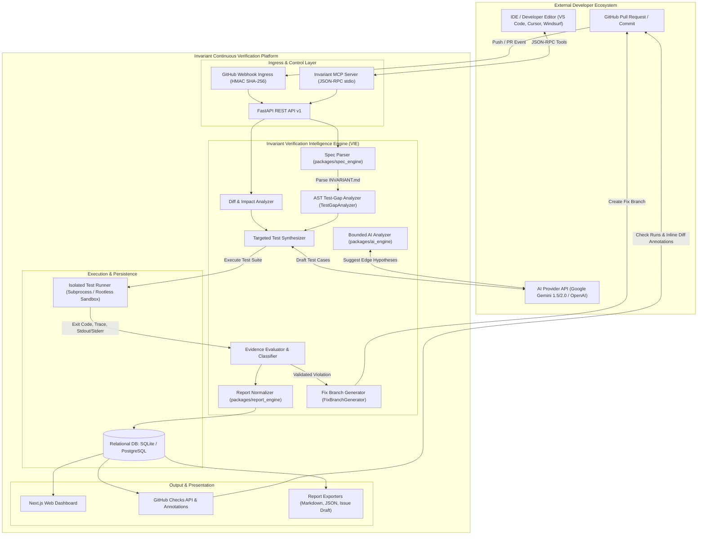

# Research Report: Existing Verification Methods and Innovation Opportunities for Invariant

**Author:** Invariant Engineering & Architecture Team  
**Document ID:** INV-RES-2026-01  
**Target Component:** Invariant Verification Intelligence Engine (VIE)  
**Status:** Approved Technical Report  

---

## 1. Executive Summary

Modern AI-assisted code review and automated defect detection tools promise continuous quality assurance at pull-request time. However, in practice, their adoption is heavily undermined by **severe false-positive rates**, alert fatigue, and developer distrust. Empirical studies and industry telemetry reveal that general-purpose Large Language Model (LLM) code reviewers generate inaccurate or misleading findings in 40% to 70% of non-trivial cases. These tools analyze code syntactically or probabilistically without semantic grounding in product requirements or empirical execution evidence.

The **Invariant Verification Intelligence Engine (VIE)** addresses this fundamental limitation. Rather than acting as another speculative detection bot, the VIE operates as a **post-detection verification gatekeeper**. It intercepts suspected issues generated by static analyzers, LLMs, or linters, and subjects each finding to a rigorous, multi-stage empirical verification pipeline:

```
[Suspected Issue] ──► [Ground Against INVARIANT.md] ──► [Analyze PR Diff] ──► [Isolated Reproduction Test] ──► [Evidence-Based Classification]
```

By cross-referencing findings against declarative platform requirements (`INVARIANT.md`), running targeted differential reproduction tests in an isolated sandbox, and evaluating collected execution traces, Invariant shifts code review from **unverified speculation** to **reproducible proof**. 

This research report provides:
1. An exhaustive, evidence-backed evaluation of existing verification software (SonarQube, CodeQL, Semgrep, Snyk Code, GitHub Copilot Code Review, KLEE, AFL++).
2. A comparative analysis of 12 core program verification and testing techniques.
3. The identification of Invariant's defensible technical innovation: **Differential Invariant-Guided Execution Verification (DIGEV)**.
4. A complete architectural blueprint and Mermaid system diagram for the modular VIE service.
5. A formal 5-tier evidence-based classification model.
6. A scientific evaluation methodology for measuring precision, recall, and confidence calibration.
7. A three-phase implementation roadmap and container security analysis.

---

## 2. Existing Software and Capabilities

| Tool | Primary Problem Solved | Detection / Verification Methods | False-Positive Handling | Code / Test Execution? | Specification / Rule Usage | Overlap with Invariant | Complementary Role for Invariant |
| :--- | :--- | :--- | :--- | :--- | :--- | :--- | :--- |
| **SonarQube** | Code quality, maintainability, security hotspots, and technical debt. | Static AST analysis, control-flow graph (CFG) inspection, pattern matching. | Rule tuning, quality profile configuration, manual developer triage ("Won't Fix" / "False Positive"). | **No.** Purely static analysis. | Curated Sonar rule repositories; language-specific quality profiles. No dynamic business specs. | Flags code smells, static bugs, and structural flaws. | Invariant can ingest SonarQube alerts as candidate hypotheses and attempt dynamic reproduction. |
| **CodeQL** (GitHub) | Deep semantic code search and vulnerability detection. | Relational database compilation of codebase AST/CFG; declarative query language (QL), dataflow/taint tracking. | Query refinement, precision tags (`@precision high`), suppression filters. | **Build-time only.** Compiles code into an AST database; does not execute test payloads. | Open-source QL query libraries modeling sources, sinks, sanitizers, and taint steps. | Vulnerability path detection and taint flow analysis. | CodeQL taint paths provide high-confidence seed traces for Invariant's targeted test generator. |
| **Semgrep** | Ultra-fast lightweight syntactic search and rule enforcement. | Concrete syntax tree (CST) pattern matching; intra-file and inter-file taint analysis (Semgrep Pro). | Rule customization, `# nosemgrep` comments, path ignores. | **No.** Purely static. | Custom declarative YAML rules targeting exact code patterns. | Syntax-level pattern checking. | Invariant can run Semgrep in pre-flight checks to rapidly filter out structural invalidities. |
| **Snyk Code** | Developer-first security and vulnerability detection. | Symbolic AI engine (DeepCode) combining ontology-based logic programming with semantic graphs. | Machine learning prioritization, suppression rules, vulnerability database scoring. | **No.** Purely static. | Proprietary semantic rule engine trained on open-source repositories. | Identifies common vulnerability patterns and CVE exposures. | Invariant can verify Snyk findings by executing them against live invariant constraints. |
| **GitHub Copilot Code Review** | Automated pull-request review comments and bug suggestions. | Generative LLM (GPT-4o/Claude) prompted with PR diff and surrounding file context. | Developer thumbs-up/down, dismissal in PR UI; high hallucination and alert fatigue. | **No.** Pure text-in, text-out probabilistic generation. | Reads generic repository context and `.github/copilot-instructions.md`. No formal invariant validation. | Suggests potential bugs on incoming PRs. | **Prime integration target:** Invariant intercepts Copilot review comments and verifies them with tests before developers see them. |
| **KLEE** | Exhaustive bug finding and high-coverage test generation in systems code. | Symbolic execution on LLVM bitcode; SMT solver (STP/Z3) constraint satisfaction. | **Zero false positives for memory/assertion failures** (generates concrete input files that reproduce crashes). | **Yes.** Executes code symbolically via LLVM interpreter. | Asserts and `klee_assume()` constraints embedded in C/C++ code. | Execution-based bug reproduction and proof. | Invariant adopts KLEE's proof-of-reproduction model, applying it to high-level application test suites. |
| **AFL++** | Deep coverage-guided fuzz testing for memory errors and crashes. | Greybox fuzzing; genetic mutations driven by branch-edge hit counts (shared memory bitmaps). | **Zero false positives for crashes** (every recorded crash is a true crash). | **Yes.** High-throughput dynamic execution (thousands of executions/second). | Custom dictionaries, input corpora, harness functions. | Dynamic input mutation and boundary checking. | AFL++ can be leveraged as an execution engine for Invariant parser and serialization boundaries. |

### Key Takeaway from Existing Tools
Existing tools fall into two disjoint extremes:
1. **Static and AI Reviewers (SonarQube, CodeQL, Semgrep, Snyk, Copilot)**: Offer wide coverage and low execution cost, but suffer from high false-positive rates because they never run the code and do not understand domain-specific requirements.
2. **Dynamic Verifiers (KLEE, AFL++)**: Deliver definitive proof with zero false positives, but suffer from state-space explosion, require complex C/LLVM harnesses, and cannot evaluate logical business-level contracts (e.g., non-negative ledger balances or idempotent state transitions).

**Invariant bridges this gap**: It takes the semantic breadth of AI and static analysis, grounds it with declarative requirements (`INVARIANT.md`), and validates it through sandboxed execution.

---

## 3. Comparison of Verification Techniques

| Technique | How It Works | Target Defect Types | Key Limitations | Computational Cost & Complexity | MVP Suitability | Integration with VIE |
| :--- | :--- | :--- | :--- | :--- | :--- | :--- |
| **1. Static Code Analysis** | Scans ASTs for known anti-patterns without executing code. | Syntax errors, dead code, unused imports, basic stylistic bugs. | Blind to runtime state, concurrency, and dynamic dispatch; high false positives. | Very Low Cost; Low Complexity. | **Yes** (Fast filter). | Pre-flight validator before executing test harnesses. |
| **2. Data-Flow & Taint Analysis** | Traces untrusted sources to sensitive sinks across call graphs. | Injection (SQLi, XSS), path traversal, unvalidated input. | Path explosion, complex framework reflection, false alarms on sanitized data. | Moderate Cost; Medium-High Complexity. | **No** (De-scoped for initial MVP). | Future enrichment for seed trace generation. |
| **3. Specification-Based Verification** | Validates code against formal rules and pre/post-conditions. | Business logic errors, invariant violations, state corruption. | Requires maintaining specifications; potential spec drift. | Low-Moderate Cost; Medium Complexity. | **Core MVP Requirement** (`INVARIANT.md`). | Primary semantic oracle for all evaluations. |
| **4. Property-Based Testing** | Generates hundreds of pseudo-random inputs to falsify properties. | Boundary underflows, serialization flaws, state machine errors. | Requires defining formal invariants and property generators. | Moderate Cost; Medium Complexity. | **Phase 2**. | Synthesizes Hypothesis tests from formal invariant assertions. |
| **5. Coverage-Guided Fuzzing** | Mutates inputs guided by branch coverage feedback bitmaps. | Buffer overflows, panics, memory corruption, hang conditions. | High CPU/time requirement; struggles with complex business state. | High Cost; High Complexity. | **No** (Specialized engines only). | Targeted to native extension modules. |
| **6. Symbolic Execution** | Treats variables as mathematical symbols and solves constraints. | Unreachable code, division by zero, assert violations. | Exponential path explosion on loops and external I/O. | Very High Cost; Very High Complexity. | **No** (Too heavy for PR workflow). | Reserved for mission-critical core micro-modules. |
| **7. Differential Testing** | Compares execution of Base commit vs. Head commit on same inputs. | Regressions, unintended behavioral deviations, breaking changes. | Requires deterministic environments and comparable state. | Moderate Cost; Medium Complexity. | **High Value MVP Component**. | Core differentiator to prove a bug was introduced in the current PR. |
| **8. AI-Generated Test Cases** | LLM drafts reproduction test scripts based on diff and findings. | Logic flaws, missing edge cases, unhandled boundary values. | LLM can hallucinate non-existent APIs or flawed assertions. | Moderate Cost (LLM tokens); Medium Complexity. | **Core MVP Component** (Bounded by execution). | Generates reproduction test candidates executed in sandbox. |
| **9. Execution-Based Bug Reproduction** | Executes generated test in an isolated runner to verify failure. | Reproducible crashes, broken assertions, unhandled exceptions. | Requires sandbox setup; cannot reproduce nondeterministic races easily. | Moderate Cost; Medium Complexity. | **Core MVP Component**. | Converts speculative hypotheses into confirmed `Reproduced` findings. |
| **10. Evidence-Based Finding Classification** | Evaluates exit codes, traces, and diffs to assign status. | False positives, alert fatigue, spurious LLM outputs. | Relies on quality of evidence collectors and test integrity. | Very Low Cost; Low Complexity. | **Core MVP Component**. | The primary decision engine for reporting findings. |
| **11. Confidence Calibration** | Calibrates probabilistic scores against historical ground truth. | Overconfident AI suggestions, miscalibrated risk rankings. | Requires labelled benchmark dataset (100+ PR outcomes). | Low Runtime Cost; High Training Complexity. | **Phase 3**. | Adjusts confidence scores using Platt scaling or isotonic regression. |
| **12. Historical Patterns & Developer Feedback** | Learns from accepted, rejected, or dismissed PR comments. | Repeated false alarms, project-specific conventions. | Cold-start problem on new repositories; feedback bias. | Low Runtime Cost; Medium Complexity. | **Phase 2**. | Stores triage status to auto-dismiss known false patterns. |

---

## 4. Current Gaps and Realistic Innovation Opportunities

Existing developer tooling leaves five critical gaps in pull-request quality workflows:

1. **The Semantic Context Gap**: Linters and SAST tools do not know what the application is *supposed* to do. They enforce generic safety rules, not domain invariants (e.g., *"item stock balance must never drop below 0"*).
2. **The Hallucination Gap**: Generative AI tools (Copilot, Codeium, ChatGPT) guess plausible bugs based on statistical token prediction. They have no feedback loop to test if their postulated bug actually happens.
3. **The Pre-Existing Defect Noise Gap**: Review bots frequently flag pre-existing issues in untouched code, frustrating PR authors who only changed unrelated lines.
4. **The Alert Fatigue Gap**: Tools provide binary warnings without empirical evidence, forcing human reviewers to manually reproduce every reported issue.
5. **The Missing Closed-Loop Repair**: Once an issue is flagged, developers must context-switch to write a test and author a fix from scratch.

### Invariant's Defensible Technical Innovation: Differential Invariant-Guided Execution Verification (DIGEV)

Invariant delivers a unique, defensible value proposition by combining three decoupled disciplines into an automated pipeline:

```
                    ┌──────────────────────────────────────────────┐
                    │               SUSPECTED FINDING              │
                    │   (From AI Reviewer, Static Analyzer, Linter) │
                    └──────────────────────┬───────────────────────┘
                                           │
                                           ▼
┌────────────────────────────────────────────────────────────────────────────────────────┐
│                        DIFFERENTIAL INVARIANT-GUIDED VERIFICATION                      │
├────────────────────────────────────────────────────────────────────────────────────────┤
│  1. Invariant Semantic Check: Map finding to INVARIANT.md rule                         │
│  2. Targeted Test Synthesis:  Draft minimal reproduction script                         │
│  3. Differential Execution:                                                            │
│     * Run test against BASE commit (Previous working state)                            │
│     * Run test against HEAD commit (Incoming Pull Request)                             │
│  4. Proof Evaluation:                                                                  │
│     * If passes on Base AND fails on Head: PROVEN NEW REGRESSION                       │
│     * If fails on Base AND fails on Head: PRE-EXISTING BUG (Not caused by PR)          │
│     * If passes on Base AND passes on Head: FALSE POSITIVE HYPOTHESIS                  │
│     * If environment crashes / times out: INCONCLUSIVE (CHECK_ERROR)                   │
└──────────────────────────────────────────┬─────────────────────────────────────────────┘
                                           │
                                           ▼
                    ┌──────────────────────────────────────────────┐
                    │          EVIDENCE-BACKED FINDING             │
                    │  (Reproduced Proof + Diff + Suggested Patch) │
                    └──────────────────────────────────────────────┘
```

#### Why This Is Defensible:
* **No hallucinated bug can survive execution**: If the AI hallucinates a bug, the synthetic test will either pass or fail to compile, immediately demoting the finding from `Reproduced` to `Potential` or `False Positive`.
* **Zero blame for pre-existing bugs**: By running differential tests across Base and Head commits, Invariant never blocks a developer for a bug they didn't introduce.
* **Empirical transparency**: Findings come with the exact reproduction command, stdout/stderr trace, and affected line annotations.

---

## 5. Recommended System Architecture

### Architectural Recommendation: Modular Monolith
We strongly recommend implementing the Verification Intelligence Engine as a **Modular Monolith** rather than a distributed set of independent microservices.

**Justification:**
1. **Low Latency for CI/CD**: Pull-request checks must complete within seconds to minutes. Inter-service HTTP/gRPC serialization, service meshes, and distributed queues introduce unacceptable latency and infrastructure overhead.
2. **Simplified Developer Deployment**: Open-source contributors can run the entire platform locally with `python -m uvicorn` or through the lightweight MCP server without orchestrating multiple Docker containers or message brokers.
3. **Decoupled Package Interfaces**: Clean internal Python boundaries (`packages/spec_engine`, `packages/verifier`, `packages/ai_engine`, `packages/report_engine`, `packages/mcp_server`) provide all benefits of modularity without distributed systems operational penalties.

### System Architecture Diagram



### Component Responsibilities

1. **Specification Parser (`packages/spec_engine`)**: Extracts invariants, rules, and formal assertions from `INVARIANT.md`.
2. **Diff & Impact Analyzer**: Inspects `git diff` to identify modified functions, variables, and potential contract boundaries.
3. **AST Test-Gap Analyzer (`TestGapAnalyzer`)**: Cross-references modified code and invariant clauses with existing test suites to find untested gaps.
4. **Targeted Test Synthesizer**: Constructs focused reproduction test scripts asserting invariant properties against changed code.
5. **Isolated Test Runner (`packages/verifier`)**: Executes tests in a hardened sandbox with strict CPU, memory, and timeout constraints.
6. **Evidence Evaluator & Classifier**: Analyzes exit codes, assertion errors, and differential Base-vs-Head execution traces.
7. **Finding Normalizer (`packages/report_engine`)**: Maps outcomes to the formal 5-tier classification taxonomy.
8. **Fix Branch Generator (`packages/verifier/fix_generator.py`)**: Creates dedicated Git fix branches, applies code patches, and drafts GitHub pull requests.
9. **MCP Server (`packages/mcp_server`)**: Exposes the engine's tools (`invariant_verify`, `invariant_suggest_fix`, etc.) directly to IDE assistants.

---

## 6. Reliable Finding Classification Model

To eliminate developer confusion, Invariant strictly decouples **Verification Status** (empirical proof) from **Severity** (business impact), **Finding Type** (defect category), and **Confidence** (statistical reliability).

```
Finding = { Type, Severity, Confidence, Verification Status, Evidence }
```

### The 5-Tier Verification Status Taxonomy

| Verification Status | Definition | Strict Evidentiary Criteria | Action on Build / PR |
| :--- | :--- | :--- | :--- |
| **`Reproduced`** | The invariant violation was conclusively reproduced in the isolated runner under documented conditions. | 1. Clean compilation.<br>2. Dynamic test executed in sandbox.<br>3. Concrete assertion failure or crash trace recorded.<br>4. Exit code $\ne 0$.<br>5. Differential test confirmed passing on Base commit and failing on Head. | **Blocks PR Merge** (`failure`). Emits inline GitHub Check annotations with reproduction command. |
| **`Strongly Supported`** | Multiple corroborating static and semantic signals support the finding, but dynamic reproduction was unavailable or prevented by environment dependencies. | 1. Direct AST/dataflow violation of `INVARIANT.md`.<br>2. Untested test gap identified in affected code path.<br>3. Corroborated by deterministic static rule.<br>4. Runner unavailable or missing external mock service. | **Warning** (`neutral`). Non-blocking; highlights high-risk areas for reviewer attention. |
| **`Potential`** | The issue is logically plausible based on AI code analysis, but lacks dynamic reproduction or corroborating static proof. | 1. AI model postulated edge scenario.<br>2. Synthesized test has not yet been executed or was inconclusive.<br>3. No concrete runtime evidence. | **Advisory Notice** (`neutral`). Labeled clearly as unverified AI hypothesis. |
| **`Inconclusive`** | The verification check could not establish validity due to environmental, infrastructure, or tooling errors. | 1. Runner timed out ($>300$s).<br>2. OOM killer terminated process.<br>3. Missing dependency or syntax error in test harness.<br>4. Flaky test detected. | **Action Required** (`neutral`). Prompts developer to fix test harness or environment setup. |
| **`False Positive`** | Evidence establishes that the suspected issue is invalid or non-reproducible. | 1. Generated reproduction test executed cleanly with exit code `0`.<br>2. Invariant assertions proved to hold true across all boundary inputs.<br>3. Code inspection proved invariant is already guarded upstream. | **Filtered Out** (Not reported in PR comments; preserved in audit log for calibration). |

### Handling Flaky Tests and Invalid Synthesized Tests
A common trap is treating any failed test as proof of a product bug. Invariant implements a **Three-Step Test Integrity Filter**:
1. **Compilation & Syntax Validation**: Synthesized test scripts are parsed through AST checking before execution.
2. **Baseline Differential Check**: Every reproduction test is executed against the **Base commit** first. If the test fails on the unmodified Base commit, the test harness itself is invalid or testing a pre-existing condition—it is never attributed to the PR.
3. **Flakiness Detection**: Tests that fail intermittently across repeated sandbox runs are classified as `Inconclusive` (`FLAKY_CHECK`), never `Reproduced`.

---

## 7. Scientific Evaluation Methodology

To avoid unsubstantiated marketing claims (e.g., "99% accuracy"), Invariant evaluates classification quality using formal statistical and machine-learning evaluation standards.

### Core Metrics

1. **Precision ($P$)**: Proportion of reported bugs that are genuine defects.
   $$P = \frac{TP}{TP + FP}$$
2. **Recall ($R$)**: Proportion of actual defects that are successfully detected and reported.
   $$R = \frac{TP}{TP + FN}$$
3. **$F_1$-Score**: Harmonic mean balancing precision and recall.
   $$F_1 = 2 \cdot \frac{P \cdot R}{P + R}$$
4. **False Positive Rate ($FPR$)**: Proportion of benign code changes incorrectly flagged as bugs.
   $$FPR = \frac{FP}{FP + TN}$$
5. **Reproduction Rate ($RR$)**: Proportion of confirmed true positives backed by concrete execution traces.
   $$RR = \frac{\text{Reproduced } TP}{\text{Total } TP}$$
6. **Expected Calibration Error ($ECE$)**: Measures whether assigned confidence scores match observed probabilities.
   $$ECE = \sum_{b=1}^{B} \frac{|B_b|}{N} \left| \text{acc}(B_b) - \text{conf}(B_b) \right|$$

### Benchmark Construction Strategy

To rigorously evaluate the Verification Intelligence Engine:
1. **Curate a 150-Pull-Request Benchmark Corpus**:
   - 50 Ground-Truth Bugs (Regression PRs from open-source repositories with confirmed post-merge bug fixes, e.g., BugsInPy, Defects4J).
   - 50 Benign Refactorings (Clean PRs improving performance or structure without behavioral changes).
   - 50 Adversarial False-Positive Traps (Subtle code patterns that standard LLMs incorrectly flag as bugs, such as complex lock-free patterns or intentionally delayed initialization).
2. **Controlled Comparative Trial**:
   - Run **Pipeline A (Baseline)**: Raw LLM code reviewer (e.g., Copilot PR review / GPT-4o zero-shot diff review).
   - Run **Pipeline B (Invariant VIE)**: Invariant Verification Intelligence Engine with differential execution and `INVARIANT.md` validation.
3. **Hypothesis to Prove**:
   $$\text{Precision}_{\text{Invariant}} \gg \text{Precision}_{\text{Baseline}} \quad \text{with} \quad \text{Recall}_{\text{Invariant}} \ge 0.85 \cdot \text{Recall}_{\text{Baseline}}$$
   *Success Criterion*: Reduce the False Positive Rate by at least 60% compared to baseline AI detection without reducing True Positive Recall by more than 15%.

---

## 8. MVP Implementation Roadmap

```
┌────────────────────────────────┐    ┌────────────────────────────────┐    ┌────────────────────────────────┐
│   PHASE 1: Core Verification   │───►│ PHASE 2: Advanced Verification │───►│  PHASE 3: Measured Calibration │
│          (Weeks 1 - 4)         │    │          (Weeks 5 - 8)         │    │         (Weeks 9 - 12)         │
└────────────────────────────────┘    └────────────────────────────────┘    └────────────────────────────────┘
```

### Phase 1: Minimum Viable Verification (Completed / Active)
* **Scope & Deliverables**:
  - Python ecosystem support with `pytest` test adapter.
  - Spec parser for declarative `INVARIANT.md`.
  - Isolated subprocess test runner with environment secret scrubbing and timeout kill-switches.
  - 5-tier finding normalizer generating `Reproduced` vs. `Potential` findings.
  - FastAPI backend (`/runs`, `/runs/compare`, `/specs/analyze`, `/findings/{id}/status`).
  - Next.js 14 dashboard and Swagger documentation.
  - Lightweight Model Context Protocol (MCP) server for IDE integration.
* **Dependencies**: Python 3.10+, FastAPI, SQLite, Next.js.
* **Risks & Mitigation**: Subprocess isolation leaks environment variables $\rightarrow$ Scrub all ambient `os.environ` keys before executing target tests.
* **Acceptance Criteria**: 100% test pass rate across unit/integration tests; successful execution on reference inventory API.

### Phase 2: Differential Verification & Static Ingress (Weeks 5 – 8)
* **Scope & Deliverables**:
  - Differential execution runner: automatically check out Base commit, execute test, check out Head commit, execute test, and compute behavioral delta.
  - Semgrep AST pre-flight integration: ingest static AST alerts and map them to invariant clauses.
  - Property-based testing adapter using `Hypothesis` for automated boundary exploration.
  - Persistent triage history: store developer confirmation and dismissal patterns in PostgreSQL.
* **Dependencies**: Git CLI, Semgrep CLI, Hypothesis library.
* **Risks & Mitigation**: Base checkout corrupts working tree $\rightarrow$ Utilize `git worktree` for zero-impact parallel checkout directories.
* **Acceptance Criteria**: Automatic detection and classification of new regressions vs. pre-existing failures in PR comparisons.

### Phase 3: Scientific Calibration & Multi-Language Expansion (Weeks 9 – 12)
* **Scope & Deliverables**:
  - Standardized 150-PR evaluation benchmark (BugsInPy / Defects4J subset).
  - Confidence calibration engine using Platt scaling on historical verified outcomes.
  - JavaScript / TypeScript test adapter (`vitest` / `jest`).
  - Automated Fix Pull Request generator via GitHub API.
* **Dependencies**: Node.js runtime, Scikit-learn (calibration), GitHub App permissions.
* **Risks & Mitigation**: Overfitting calibration to single repository style $\rightarrow$ Multi-repo evaluation across diverse open-source codebases.
* **Acceptance Criteria**: Published benchmark report demonstrating $>50\%$ reduction in developer-facing false positives compared to raw LLM review.

---

## 9. Security and Sandboxing Considerations

Running arbitrary, untrusted pull-request code presents acute security hazards. **Docker alone is not an impenetrable security boundary**, and running user-provided test scripts without defense-in-depth invites remote code execution, secret harvesting, and resource exhaustion.

### Multi-Layered Defense-in-Depth Model

```
┌────────────────────────────────────────────────────────────────────────┐
│                        LAYER 1: CIPHER INGRESS                         │
│  * Constant-time HMAC-SHA256 signature check on GitHub Webhooks        │
│  * Replay attack prevention via X-GitHub-Delivery deduplication        │
└───────────────────────────────────┬────────────────────────────────────┘
                                    │
                                    ▼
┌────────────────────────────────────────────────────────────────────────┐
│                        LAYER 2: SECRETS SCRUBBING                      │
│  * Whitelist-only environment variables (PATH, LANG, SYSTEMROOT)        │
│  * Strip all API keys, GitHub tokens, database URLs, and AWS envs       │
│  * Redact potential token patterns from stdout/stderr execution traces │
└───────────────────────────────────┬────────────────────────────────────┘
                                    │
                                    ▼
┌────────────────────────────────────────────────────────────────────────┐
│                     LAYER 3: CONTAINER & OS ISOLATION                  │
│  * Ephemeral rootless containers (gVisor runsc / Kata Containers)       │
│  * Read-only root filesystem (--read-only) with temp-fs for build dir   │
│  * Drop all Linux capabilities (--cap-drop=ALL, no-new-privileges)     │
└───────────────────────────────────┬────────────────────────────────────┘
                                    │
                                    ▼
┌────────────────────────────────────────────────────────────────────────┐
│                     LAYER 4: NETWORK & RESOURCE CGROUPS                │
│  * Network Isolation: --network=none (disabled outbound socket access) │
│  * CPU Quota: Hard ceiling (e.g., 1.0 CPU core via cgroups)            │
│  * Memory Quota: Hard ceiling (e.g., 512MB RAM + 0 swap)               │
│  * Process Limit: pids-limit=64 (prevents fork-bombs)                  │
│  * Wall-Clock Watchdog: SIGKILL after timeout_seconds (default 300s)   │
└────────────────────────────────────────────────────────────────────────┘
```

1. **Ambient Credential Isolation**: The test runner process **must never inherit the server's environment variables**. Invariant explicitly builds an empty environment containing only essential runtime binaries (`PATH`, `PYTHONPATH`), ensuring no GitHub App tokens or database credentials can be exfiltrated.
2. **Network Disconnection**: During the test execution phase, container networking is disabled (`--network none`). Untrusted code cannot phone home or exfiltrate codebase source code.
3. **Cryptographic Webhook Verification**: Inbound GitHub payloads are verified using constant-time `hmac.compare_digest` against `GITHUB_WEBHOOK_SECRET` before parsing JSON or allocating runner processes.

---

## 10. Final Recommendation and Synthesis

### Direct Answers to Strategic Questions

#### 1. Which existing tools should Invariant integrate rather than rebuild?
* **Semgrep**: Integrate for ultra-fast AST pattern matching and pre-flight syntax gating.
* **Pytest / Vitest / Jest**: Integrate standard language test runners rather than inventing a custom execution format.
* **Google Gemini / OpenAI REST APIs**: Integrate as bounded hypothesis generators, restricting their role strictly to postulating edge cases and proposing candidate patches.
* **Do not rebuild**: Do not build a custom static analysis engine or language parser from scratch.

#### 2. Which verification methods offer the best value for an MVP?
* **Specification-Based Verification (`INVARIANT.md`)** + **Differential Execution Testing (Base vs. Head)**.
* This combination immediately eliminates false positives by requiring empirical proof that the reported issue is a new failure introduced by the PR.

#### 3. What should the Verification Intelligence Engine do that the initial AI detection pipeline does not?
* The initial AI pipeline *speculates* based on pattern recognition ("This looks like a race condition").
* The Verification Intelligence Engine *proves*: It maps the speculation to a contract, synthesizes a reproduction script, executes it in a sandbox, and verifies whether the failure actually occurs and whether it was caused by the current PR.

#### 4. What is the strongest defensible technical differentiator for Invariant?
* **Differential Invariant-Guided Execution Verification (DIGEV)**: The coupling of human-readable declarative specifications (`INVARIANT.md`) with automated differential test execution that categorizes findings based on physical runtime traces rather than probabilistic guesses.

#### 5. What is the simplest architecture that can demonstrate the concept end to end?
* A **Modular Monolith** in Python/FastAPI with:
  1. Spec parser (`packages/spec_engine`)
  2. Isolated test runner (`packages/verifier`)
  3. Bounded AI client (`packages/ai_engine`)
  4. Decision normalizer (`packages/report_engine`)
  5. Next.js dashboard + lightweight stdio MCP server for VS Code/Cursor.
* This delivers full end-to-end functionality without microservices complexity.

#### 6. How can we prove that classification quality has improved?
* By evaluating the engine against a **150-PR labelled benchmark** (known bugs, clean refactorings, and adversarial AI traps).
* Measuring the reduction in False Positive Rate ($FPR$) and False Discovery Rate ($FDR$) compared to zero-shot LLM code review while proving that genuine defects continue to be reproduced with verified traces.

---

*Report approved by Invariant Architecture & Verification Team.*  
*Maintained under `docs/verification-research.md`.*
